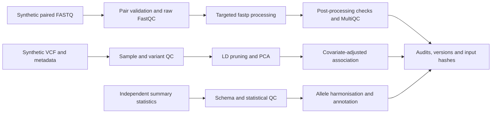
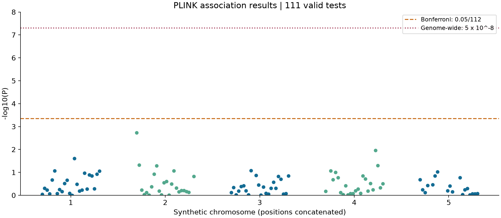
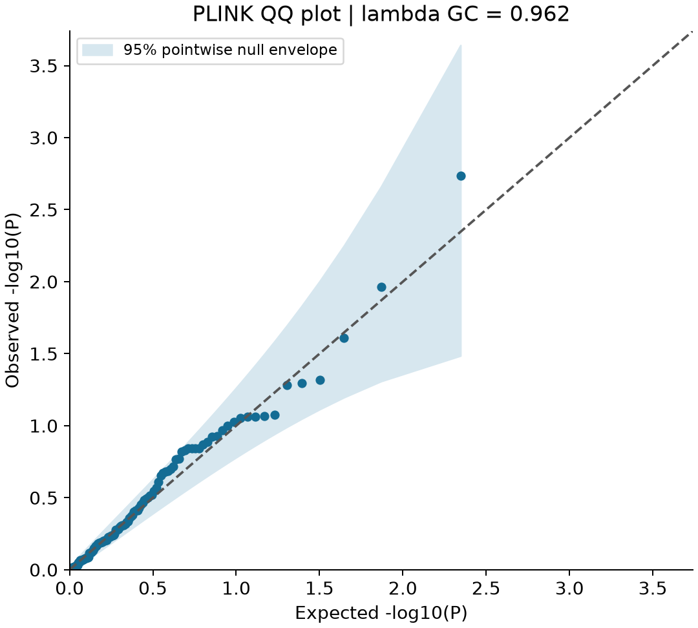
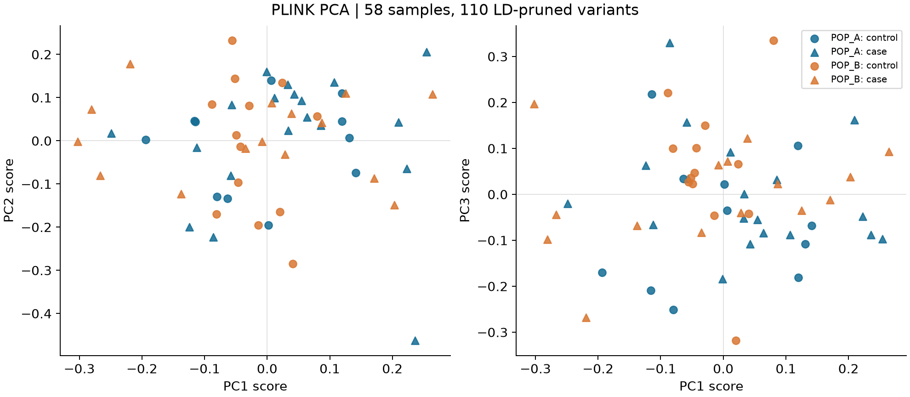

# Reproducible sequence and genetic association quality control

## Study overview

This repository evaluates reproducible quality control of sequencing reads, individual-level genotypes, and genetic association summary statistics using small synthetic datasets from the SBIMB Practice Pack Refined. The objective is to make exclusion decisions, allele harmonisation, statistical failures, and computational provenance inspectable. The results describe workflow behaviour on synthetic inputs and do not support biological or clinical conclusions.

A single command executes three independent analysis branches. The FASTQ reads are not the source of the supplied VCF, and the summary statistics are not generated by the genotype association analysis. No read alignment, variant calling, imputation, or meta-analysis is performed.



## Materials and methods

### Sequence reads

Three pairs of compressed FASTQ files contain 500 pairs each. The fixtures encode quality as Phred+33. Pairing, record structure, sequence/quality lengths, DNA characters, quality range, duplicate read names, and retained pair counts are checked. The original synthetic headers have different terminal mate tokens, `2001` and `2002`; an explicitly fixture-specific conversion validates the complete expected identifier and record order before writing normalised names to output copies. It does not infer pairing for arbitrary files or modify raw inputs.

FastQC is run before and after processing, with separate MultiQC reports. Direct Phred+33 measurements determine whether low-quality bases or the observed fixture adapter `AGATCGGAAGAGCACACGTCTGAACTCCAG` require processing. fastp uses that adapter for both mates, tail trimming at mean quality 20, and minimum length 30. The final fixture checks require no full-length fixture adapter or bases below Q20 to remain. These checks are tailored to the supplied fixtures; absence of the full adapter does not establish absence of every possible partial adapter in real libraries.

FastQC automatically infers an older encoding for the uniformly high-quality synthetic reads, reporting Q9 where the specified Phred+33 encoding gives Q40. Consequently, raw FastQC quality flags are retained and explained rather than treated as reliable evidence for trimming these fixtures. Automatic paired-end adapter detection also missed the inserted adapter in an initial run; the final workflow supplies the verified sequence explicitly. Residual FastQC composition/overrepresentation flags can reflect the small synthetic sample and must be interpreted alongside the per-base checks.

### Genotype quality control and association analysis

The input comprises 60 samples and 120 autosomal biallelic variants, with age, sex, population labels, and a binary phenotype (1 = control; 2 = case). Metadata are matched by sample identifiers. Exact genotype duplicates are identified before sample filtering. Within-population heterozygosity is screened using six scaled median absolute deviations with a 0.005 floor. Sample and variant missingness limits are 10%, minor allele frequency is at least 1%, and minor allele count is at least five.

Hardy-Weinberg equilibrium is evaluated in controls within each supplied population; variants with P < 1e-6 in either group are excluded. The retained control groups contain 11 and 13 samples, so these tests have limited power. LD pruning uses a 50-variant window, step five, and r-squared threshold 0.2. Three principal components are calculated from the pruned panel. Association analysis uses the complete QC-retained panel and adjusts for age, sex, and PC1-PC3 with PLINK 2 logistic regression and Firth fallback. Failed tests remain in the audit and are excluded from significance summaries. The Bonferroni denominator includes all 112 attempted variants.

Exact duplicate detection does not replace genome-wide kinship estimation. Sex concordance cannot be assessed from this autosomal fixture. Thresholds and sample size are appropriate for a computational check, not a validated cohort-analysis protocol.

### Summary statistics and harmonisation

The independent 58-row table is screened for schema consistency, finite numeric values, valid autosomal coordinates and alleles, positive standard errors and sample sizes, P values in (0,1], INFO >= 0.8, and minor allele frequency >= 0.01. Exact duplicates are collapsed; conflicting identifiers or locus-level effects are quarantined. Equivalent swapped-allele aliases are collapsed after orienting effects and frequencies.

Partner records are checked against the synthetic SIM1 coordinate system, including allele alignment, effect/frequency reversal, and Wald P-value consistency. Ambiguous palindromic pairs are excluded from combination. This process produces a harmonisation audit, not a meta-analysis. Annotation is a left join so missing annotations do not silently remove valid associations. SIM1 is not a human reference assembly, and the gene labels are synthetic.

### Computational stages and output provenance

The driver in `scripts/run_workflow.py` resolves executables before starting, refuses an existing output directory, and writes command lines and individual tool logs as each step executes. The three branches share provenance recording but use independent inputs. The table describes the implemented order and the evidence produced.

| Stage | Implementation and decision | Recorded evidence |
|---|---|---|
| 1. Input validation | Verify FASTQ structure and fixture pair IDs; require VCF GT fields and unique sample/variant identifiers; match phenotype/covariate IDs; validate summary-table schema. | Input SHA-256 hashes and explicit errors on malformed inputs. |
| 2. Read QC | Run raw FastQC; measure Phred+33 quality and full fixture-adapter occurrence; process only affected pairs with fastp; validate output pairing and residual fixture defects. | Raw/processed FastQC, two MultiQC reports, fastp reports, read retention and base-level metrics. |
| 3. VCF import | `--vcf ... --double-id --make-pgen`; retain matching FID/IID conventions and report initial missingness. | PGEN/PVAR/PSAM files and missingness reports in the run directory. |
| 4. Sample QC | Identify exact genotype duplicates, assess within-population heterozygosity, and apply `--mind 0.10`. P059 duplicates P001; P060 fails missingness. No additional heterozygosity outlier is removed. | `sample_audit.tsv`, `remove.tsv`, and PLINK sample-filter logs; 60 to 58 samples. |
| 5. Variant QC | Apply `--geno 0.10 --maf 0.01 --mac 5` after sample filtering. | 120 to 112 variants; frequency and missingness reports. |
| 6. Control HWE | Run `--hardy` separately in POP_A and POP_B controls; union exclusions with P < 1e-6. | Two HWE reports and control-group counts; zero HWE exclusions. |
| 7. LD and PCA | `--indep-pairwise 50 5 .2`, then `--extract ld.prune.in --pca 3`. | 110-marker prune list, eigenvectors and eigenvalues. |
| 8. Association | Join age, sex and PC1-PC3 by IID; standardise age/PC covariates; run additive logistic regression with Firth fallback on all 112 QC variants. | Original PLINK output, valid-only table, and audit retaining every attempted additive test. |
| 9. Summary QC | Validate values/ranges, resolve exact and allele-oriented duplicates, quarantine conflicts, select P < 5e-8, and retain unannotated rows. | 41 clean rows, 17 exclusions, four synthetic hits, and annotation table. |
| 10. Harmonisation | Check SIM1 coordinates, allele orientation, ambiguous palindromes, and partner Wald P-value agreement within 0.05 log10 units. Swap beta sign and replace EAF with 1-EAF when needed. | Twelve-row audit with six rows ready for combination; no combined effect estimate is calculated. |
| 11. Reporting | Export compact evidence; plot valid PLINK P values and ID-matched PCA scores; calculate ranked odds ratios and approximate confidence intervals. | Three PNG figures, complete ranked table, joined PCA table and plotting versions/metrics. |

The fitted association model is:

```text
logit[Pr(case)] = intercept + beta_G * effect-allele dosage
                 + beta_age * age + beta_sex * sex
                 + beta_PC1 * PC1 + beta_PC2 * PC2 + beta_PC3 * PC3
```

Sex is supplied as the numeric two-level covariate 1/2; age and PC covariates are variance-standardised by PLINK. Population labels are used for QC grouping and figure annotation; they are not an additional regression covariate. With two levels, the numeric sex term represents the difference between the two coded groups. These data have a binary endpoint; this is not a survival GWAS.

The association command issued by the driver has the following form (paths are relative to the run's genotype directory for illustration):

```bash
plink2 --pfile qc --pheno /path/to/data/genotype/phenotype.tsv \
  --pheno-name PHENO --covar covariates.tsv \
  --covar-name AGE,SEX,PC1,PC2,PC3 \
  --covar-variance-standardize AGE,PC1,PC2,PC3 \
  --glm hide-covar firth-fallback --out assoc
```

Use the driver for a complete run; the actual absolute paths and commands are recorded in each run's `commands.sh`. The audit distinguishes a completed workflow from a successful statistical fit. Exact duplicate removal, a small-panel HWE test and three PCs do not substitute for full cohort QC, kinship analysis, reference-based ancestry assessment, batch checks, imputation QC or replication.

## Results

| Analysis | Input | Retained / outcome |
|---|---:|---|
| Paired reads | 1,500 pairs | 1,500 pairs; no residual full fixture adapter or bases below Q20 |
| Genotype samples | 60 | 58 (34 cases; 24 controls) |
| Genotype variants | 120 | 112; 110 LD-pruned markers for PCA |
| Association tests | 112 attempted | 111 valid; 1 failed; 0 Bonferroni or genome-wide significant |
| Summary statistics | 58 rows | 41 retained; 17 excluded; 4 at P < 5e-8 |
| Partner harmonisation | 12 rows | 6 ready for combination |

| Read fixture | Pairs before / after | Bases before / after | Q30 fraction before / after | Full adapter reads before / after |
|---|---:|---:|---:|---:|
| sample_adapter | 500 / 500 | 100,000 / 93,994 | 100% / 100% | 200 / 0 |
| sample_good | 500 / 500 | 100,000 / 100,000 | 100% / 100% | 0 / 0 |
| sample_lowqual | 500 / 500 | 100,000 / 68,995 | 70% / 100% | 0 / 0 |

### PLINK GWAS results and diagnostic figures

The adjusted PLINK analysis attempted 112 additive tests in 58 samples. Of these, 111 produced valid statistics; one constant-dosage variant was excluded from the figures and ranking. No variant passed the panel-wide Bonferroni threshold (0.05/112 = 0.0004464) or the conventional genome-wide threshold (5e-8). The smallest P value was 0.001838 for v0025. The table below reports the ten smallest P values as descriptive results, not significant discoveries.

| Variant | Chr:position | Effect / other allele | Effect allele frequency | OR (95% Wald CI) | P value | N |
|---|---|---|---:|---:|---:|---:|
| v0025 | 2:2010000 | G / A | 0.336 | 8.125 (2.175-30.355) | 0.001838 | 58 |
| v0093 | 4:4210000 | G / A | 0.078 | 0.084 (0.012-0.565) | 0.01087 | 58 |
| v0014 | 1:1140000 | T / C | 0.319 | 3.110 (1.156-8.369) | 0.02467 | 58 |
| v0026 | 2:2020000 | T / C | 0.138 | 4.551 (1.014-20.432) | 0.04797 | 58 |
| v0094 | 4:4220000 | T / C | 0.190 | 0.361 (0.130-1.003) | 0.05069 | 58 |
| v0033 | 2:2090000 | G / A | 0.345 | 2.565 (0.992-6.636) | 0.05205 | 58 |
| v0057 | 3:3090000 | G / A | 0.353 | 0.467 (0.197-1.108) | 0.08405 | 58 |
| v0075 | 4:4030000 | C / A | 0.233 | 2.337 (0.887-6.157) | 0.08585 | 58 |
| v0040 | 2:2160000 | T / G | 0.207 | 2.700 (0.868-8.395) | 0.08622 | 58 |
| v0006 | 1:1060000 | T / C | 0.328 | 0.501 (0.228-1.104) | 0.08641 | 58 |

Odds ratios refer to the PLINK A1 effect allele relative to the omitted allele, conditional on the model covariates. The confidence intervals are calculated as exp[log(OR) +/- 1.96 SE(log OR)]. They are approximate, unadjusted Wald intervals, not multiplicity-adjusted intervals or Firth profile-likelihood intervals. No valid test required Firth fallback in this run.

Download the [unaltered PLINK association output](results/genotype/assoc.PHENO.glm.logistic.hybrid), [complete ranked results with confidence intervals](results/genotype/plink_ranked_results.tsv), and [audit including the failed test](results/genotype/association_audit.tsv).



**Figure 1.** Manhattan plot of the synthetic genotype association analysis. Chromosomes alternate in colour; positions are concatenated across the five represented chromosomes. The dashed orange line denotes the panel-wide Bonferroni threshold and the dotted red line denotes P = 5e-8. The absence of threshold-crossing variants is consistent with the reported results. Failed tests are omitted, while the Bonferroni denominator retains all 112 attempted tests.



**Figure 2.** Observed versus expected negative log10 P values from 111 valid tests. Expected uniform quantiles are (i - 0.5)/n. The shaded region is a 95% pointwise envelope from Beta(i, n + 1 - i) order statistics under independent uniform null P values; correlation among variants limits this reference approximation. The genomic inflation factor is median[chi-square inverse-survival(P, 1 df)] / median[chi-square(1 df)] = **0.962**. This is a descriptive diagnostic based on a small synthetic panel, not evidence that confounding has been eliminated. No genomic-control correction was applied to the reported P values.



**Figure 3.** PC1-PC2 and PC1-PC3 scores from 110 LD-pruned variants in 58 retained samples. Colour identifies the supplied synthetic population label and shape identifies case/control status. The groups overlap substantially in these projections; they should not be interpreted as validated ancestry clusters. Axes show eigenvector scores. Variance-explained percentages are not estimated from only the three exported eigenvalues. Eigenvector signs may reverse between numerical implementations without changing the underlying geometry. Download [PCA scores and metadata](results/genotype/pca_metadata.tsv), [original eigenvectors](results/genotype/pcs.eigenvec), and [eigenvalues](results/genotype/pcs.eigenval).

### Independent summary-statistics results

| Synthetic summary variant | Effect allele | Beta | SE | P value |
|---|---|---:|---:|---:|
| rs0002 | C | 0.3400 | 0.0450 | 4.171e-14 |
| rs0011 | A | -0.3100 | 0.0430 | 5.624e-13 |
| rs0025 | A | 0.2900 | 0.0410 | 1.514e-12 |
| rs0030 | C | 0.1596 | 0.0290 | 3.733e-08 |


The four significant rows in the independent summary-statistics fixture are synthetic signals; they are not discoveries from the 58-sample genotype analysis. Two retained summary variants lack an annotation. Six of twelve partner rows meet harmonisation requirements.

The genotype analysis has one failed test, v0107 (`CONST_OMITTED_ALLELE`), indicating constant omitted-allele dosage. It is preserved in [the association audit](results/genotype/association_audit.tsv); it is not converted to P = 1 or counted as a valid test. This behaviour follows the [PLINK 2 error-code documentation](https://www.cog-genomics.org/plink/2.0/assoc).

Machine-readable evidence includes [validation and input hashes](results/validation.json), [software versions](results/versions.json), [sample QC](results/genotype/sample_audit.tsv), [summary exclusions](results/summary/audit.tsv), [harmonisation](results/summary/harmonisation.tsv), and [raw/post-processing FastQC flags](results/reads/fastqc_modules.tsv). Complete HTML reports, command logs, and intermediate files remain in the local run directory, which is excluded from Git.

## Reproduction on Linux or Windows with WSL

Run commands from the repository root in a Linux shell. Windows PowerShell does not execute the analysis tools directly. On this machine Toshiba is accessible in WSL at `/mnt/toshiba`; a normal WSL installation may expose it as `/mnt/d` instead. Confirm the mount with `ls` before changing directory.

```bash
cd /mnt/toshiba/SBIMB_Practice_Pack_Refined/github_workflow
# If the tools are not already available, create an environment once:
conda env create -f environment.yml
conda activate synthetic-qc
bash run.sh --out runs/my_run --threads 2
python3 -m unittest discover -s tests -v
python3 scripts/export_results.py runs/my_run --out results
python3 scripts/plot_results.py --results results --data data
```

The plotting step requires Matplotlib, NumPy and SciPy, included in `environment.yml`. Figures can be regenerated directly from the committed results without rerunning PLINK: `python3 scripts/plot_results.py`. It validates test counts and PCA sample counts against the run manifest. Plotting versions and diagnostics are recorded in [plot_metrics.json](results/plot_metrics.json).

The environment YAML is a portable dependency specification, not a fully resolved lockfile; inspect the recorded versions when comparing runs. The final validation used existing tools rather than installing this environment. On the tested machine PLINK was outside the default PATH, so the full run used:

```bash
PLINK2=/home/vusi/miniforge3/bin/plink2 /usr/bin/python3 scripts/run_workflow.py --out runs/validation03
```

Each execution requires a new output directory and refuses to overwrite an existing run. `--stage summary` needs only Python; `--stage reads` needs FastQC, fastp and MultiQC; `--stage genotype` needs PLINK 2. `FASTQC`, `FASTP`, `MULTIQC`, and `PLINK2` environment variables can select explicit executable paths. Runs record executed commands, tool versions, per-step logs, and input SHA-256 hashes. PASS denotes completed workflow checks; it does not mean all FastQC modules or individual association tests passed.

## Execution on an HPC cluster

The same scripts run on a Linux cluster. Toshiba holds the local files; the cluster has its own storage and cannot access a Windows `D:` path. Copy the repository to the cluster, activate the tools there, and submit the supplied Slurm wrapper. `ssh` opens a session on the login node; `sbatch` requests resources and runs the job on a compute node. No remote job has been submitted or tested for this repository.

From the local Linux/WSL terminal, replace the account and host placeholders:

```bash
scp -r github_workflow USER@CLUSTER:~/synthetic-qc
ssh USER@CLUSTER
```

Run the copy command from the parent directory; exclude `runs/` when transferring large analyses (for example, use rsync with `--exclude runs/`). On the cluster:

```bash
cd ~/synthetic-qc
# Activate an existing site-approved environment or load the required modules.
conda activate synthetic-qc
command -v python3 fastqc fastp multiqc plink2
mkdir -p logs
sbatch hpc/workflow.slurm
# Or run just the Python summary branch:
sbatch hpc/workflow.slurm summary
squeue -u "$USER"
# Substitute the job number printed by sbatch:
sacct -j JOB_ID --format=JobID,State,ExitCode,Elapsed,MaxRSS
```

The wrapper requests two CPUs, 4 GB RAM and 30 minutes for these small fixtures. Add your institution's required account/partition options to the submission command. The environment must be available on compute nodes, and installation policies are site-specific. Results are written under `runs/slurm-JOB_ID`; scheduler output goes to `logs/`. Slurm uses the submission directory as supplied through `SLURM_SUBMIT_DIR`; see the [official sbatch documentation](https://slurm.schedmd.com/sbatch.html). A local shell check of the wrapper is not a cluster execution test.

To retrieve a completed run, execute this from the local repository directory:

```bash
scp -r USER@CLUSTER:~/synthetic-qc/runs/slurm-JOB_ID runs/
```

## Validation and repository scope

The full workflow was executed under Ubuntu 24.04 in WSL on 23 October 2026 using the Toshiba copy. Twelve automated tests cover malformed numeric fields, duplicates/conflicts, allele swapping, palindromic ambiguity, malformed tables, pairing, fixture header repair, record order and quality-length mismatches. Shell entry points passed syntax checks. Input hashes were unchanged during execution. This is a small-data integration test, not a performance benchmark or validation on human research data.

The repository contains the synthetic inputs, executable scripts, tests, environment specification, Slurm wrapper, and compact results. Historical terminal transcripts and institution-specific login details are deliberately not included. The original source pack remains unchanged. The source repository is [Genome-wide-association-studies](https://github.com/Vusumuzi2Mabasa/Genome-wide-association-studies). Licensing of the supplied materials should be established before adding a redistribution licence.
